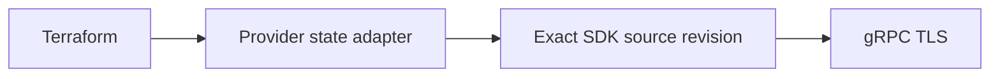

# Shared SDK candidate

## Purpose

Keep the existing provider surface on one shared CVP SDK and protobuf owner.
This is a development candidate, without a published SDK module version.

## Scope

Workspace and Studio Inputs CRUD, six Workspace Actions and `studio_path` keep
their current HCL/schema, state mapping, import IDs and prefix-overlap guard.
Change Control remains a schema-only stub. No live acceptance is claimed.

## Dependency flow



## Development

The source pin is `.sdk-source.json`: private `ioplane/arista-cvp-re`, commit
`2f2daf0dcbd221638434c1e2589137c059b65fcb`, module `sdk/go`.
With authorized repository access, prepare a clean source checkout on the host:

```bash
gh repo clone ioplane/arista-cvp-re .cache/cvp-sdk/source
git -C .cache/cvp-sdk/source checkout --detach 2f2daf0dcbd221638434c1e2589137c059b65fcb
task sdk-check
task all
```

The container must already be running (`task up`). `CVP_SDK_SOURCE` optionally
selects another checkout visible inside the container; its HEAD and module
worktree must match the pin. `task sdk-check` writes an ignored temporary
`go.work`. Go tasks use it explicitly. `task tidy` uses an alternate modfile
and removes the temporary local marker and replace before writing metadata.
The committed `go.mod` carries no fake SDK version or local replace.

The candidate CI action checks out that exact commit with
`persist-credentials: false`. The public provider's automatic job token cannot
read the private SDK repo; a separately authorized read-only
`CVP_SDK_READ_TOKEN` is required. Do not substitute personal session credentials
or make private source public to bypass this gate. Release remains blocked
until an approved immutable SDK module is published and adopted.

## Runtime boundary and pitfalls

The adapter preserves provider sentinels for missing Workspace/Inputs and the
flat Workspace state. SDK transport owns TLS 1.3, identity metadata and RPC
clients. `session` now uses the `access_token` cookie; `bearer` uses
Authorization. This transport correction has no HCL schema change.

Each Workspace Action creates its UUID once and includes it in error diagnostics.
An RPC error after submission starts has unknown outcome: reconcile that request
before any resubmission. The SDK configures no mutation replay; native transparent
gRPC retries do not prove server deduplication. Workspace deletion confirms the
exact abandon response before config deletion and refuses unknown workspace
states. Caller context bounds the operation; no new timeout setting is added.

`api/proto` is archived provenance; no task or CI job regenerates `internal/pb`.
`TestProviderUsesSingleProtoOwner`, the request-ID regression, existing state/ID
and overlap tests, acceptance-tag compilation and offline Terraform schema
comparison validate the migration. They do not replace separately scoped lab
acceptance or Registry publication.

## References

- [Exact SDK source](https://github.com/ioplane/arista-cvp-re/tree/2f2daf0dcbd221638434c1e2589137c059b65fcb/sdk/go).
- [Go workspaces](https://go.dev/ref/mod#workspaces).
- [Private checkout permissions](https://github.com/actions/checkout#checkout-multiple-repos-private).
- [Superseded local generation](../adr/0005-custom-cvp-client.md).
