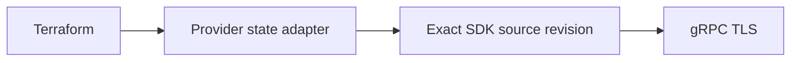

# Кандидат общего SDK

## Назначение

Перевести существующие возможности provider на общий CVP SDK и единственного
владельца protobuf types. Это кандидат для разработки, без опубликованной версии SDK module.

## Границы

Workspace и Studio Inputs CRUD, шесть Workspace Actions и `studio_path`
сохраняют текущие HCL/schema, отображение state, import IDs и prefix-overlap guard.
Change Control остаётся schema-only stub. Live acceptance не заявляется.

## Поток зависимостей



## Разработка

Pin исходников задан в `.sdk-source.json`: private `ioplane/arista-cvp-re`, commit
`2f2daf0dcbd221638434c1e2589137c059b65fcb`, module `sdk/go`.
При наличии разрешённого доступа создайте чистый checkout на host:

```bash
gh repo clone ioplane/arista-cvp-re .cache/cvp-sdk/source
git -C .cache/cvp-sdk/source checkout --detach 2f2daf0dcbd221638434c1e2589137c059b65fcb
task sdk-check
task all
```

Контейнер должен быть запущен (`task up`). `CVP_SDK_SOURCE` при необходимости
выбирает другой checkout, доступный внутри контейнера; его HEAD и module
worktree должны совпадать с pin. `task sdk-check` создаёт игнорируемый временный
`go.work`. Go tasks используют его явно. `task tidy` работает с alternate modfile
и удаляет временный local marker и replace до записи metadata.
В committed `go.mod` нет вымышленной версии SDK или local replace.

Candidate CI action получает точный commit с `persist-credentials: false`.
Автоматический job token public provider не имеет доступа к private SDK repo;
требуется отдельно разрешённый read-only `CVP_SDK_READ_TOKEN`. Нельзя заменять
его credentials персональной сессии или публиковать private source для обхода
этой проверки. Release заблокирован до разрешённой публикации immutable SDK
module и перехода на него.

## Runtime и ограничения

Адаптер сохраняет provider sentinels для отсутствующих Workspace/Inputs и
плоский Workspace state. SDK transport отвечает за TLS 1.3, identity metadata
и RPC clients. `session` теперь использует cookie `access_token`, `bearer` —
Authorization. Эта корректировка transport не меняет HCL schema.

Каждый Workspace Action создаёт UUID один раз и сохраняет его в error diagnostics.
Ошибка RPC после начала отправки означает неизвестный результат: проверьте
состояние запроса перед повторной отправкой. SDK не настраивает replay мутаций;
нативные transparent gRPC retries не доказывают server deduplication. Удаление
Workspace подтверждает точный abandon response перед удалением config и
отказывается работать с неизвестными workspace states. Операцию ограничивает
caller context; новая настройка timeout не добавляется.

`api/proto` остаётся архивом provenance; tasks и CI больше не создают `internal/pb`.
`TestProviderUsesSingleProtoOwner`, regression request ID, существующие state/ID
и overlap tests, компиляция acceptance tag и offline сравнение Terraform schema
проверяют миграцию. Они не заменяют отдельно согласованные lab acceptance и
публикацию в Registry.

## Источники

- [Точный SDK source](https://github.com/ioplane/arista-cvp-re/tree/2f2daf0dcbd221638434c1e2589137c059b65fcb/sdk/go).
- [Go workspaces](https://go.dev/ref/mod#workspaces).
- [Доступ к private checkout](https://github.com/actions/checkout#checkout-multiple-repos-private).
- [Прежняя локальная генерация](../adr/0005-custom-cvp-client.md).
